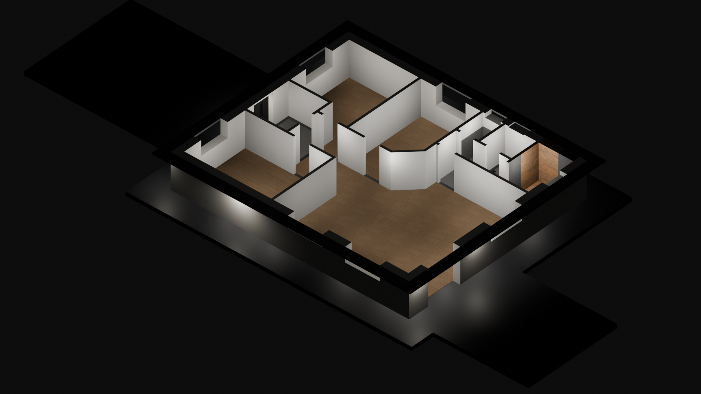
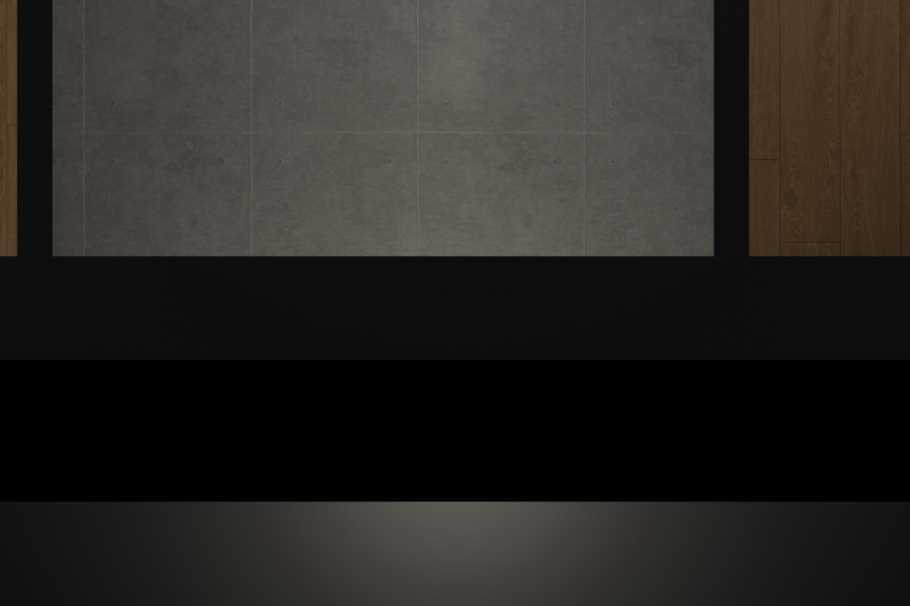
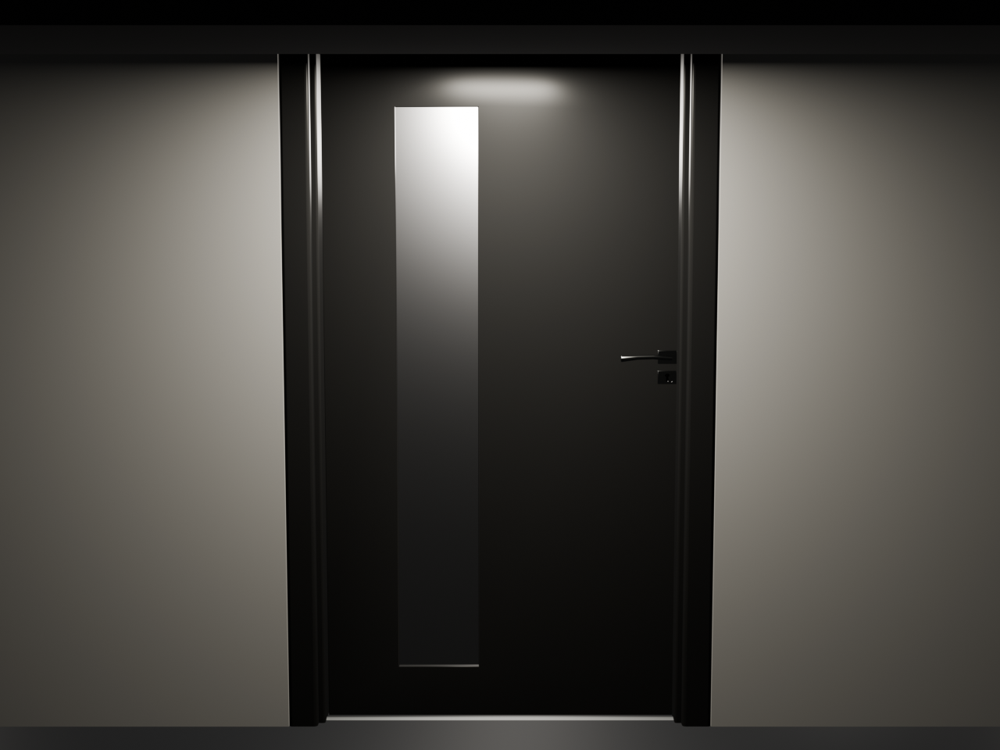

# BlenderHome3D

> **1:1 Parametrický a procedurální 3D model rodinného domu v Blenderu 5.2+**  
> Kompletní architektonický řez s přesnou návazností na projektovou dokumentaci, začištěnými stavebními otvory, 100% ortogonální dlažbou, elektroinstalací a PBR materiály.

---

## 📸 Náhledy a Výsledky Modelování

| Celkový izometrický pohled | Začištěné vchodové dveře shora | Vchod a příjezdová plocha |
| :---: | :---: | :---: |
|  |  |  |

---

## 🚀 Rychlý Start (1:1 Rebuild z nuly)

Pro kompletní sestavení celého 1:1 identického modelu z prázdné scény stačí spustit jediný příkaz:

```powershell
& "C:\Program Files\Blender Foundation\Blender 5.2\blender.exe" --background --python build_complete_model.py
```

Skript provede:
1. **Inicializaci materiálů** (fasádní omítka, vnitřní štuk, dlažby, laminát, antracitová dlažba, římsa, dřevo sprchy, obklad koupelny).
2. **Vygenerování základové desky a zpevněných ploch** (100% pravoúhlá quad síť bez šikmých hran, okapový chodník 1.2 m, terasa 5x6 m, příjezd 6x9 m).
3. **Konstrukci obvodových zdí** ($10.0 \times 12.0\text{ m}$, tl. $0.365\text{ m}$, výška $1.800\text{ m}$, 11 stavebních otvorů pro okna a dveře, začisťující boční pera a horní nadpraží dveří).
4. **Konstrukci vnitřních příček** (11 místností, tl. $0.125\text{ m}$, 8 vnitřních dveří, $45^\circ$ zkosení u koupelny).
5. **Nášlapné vrstvy podlah** (11 samostatných místností s dlažbou a laminátem).
6. **Střešní římsu / atiku** ($11.0 \times 13.0\text{ m}$, výška $Z \in [1.72, 1.80]\text{ m}$).
7. **Osazení vchodových dveří** (přesné usazení rámu, křídla a kliky bez jakýchkoliv štěrbin).
8. **Instalaci světelného plánu** (21 stropních bodovek, 5 fasádních svítidel v římse, 2 venkovní na terase, Sun_Fill).
9. **Nastavení ortografické kamery** (`Isometric_Camera`, ortho_scale 16.5) a automatické vyrenderování náhledu.

---

## 📐 Podrobná Specifikace

Kompletní matematický a technický rozpis každé stěny, otvoru, světla a materiálu naleznete v samostatném souboru:
👉 **[BUILD_SPECIFICATION_1TO1.md](BUILD_SPECIFICATION_1TO1.md)**

---

## 📂 Struktura Repozitáře

```
BlenderHome3D/
├── assets/
│   └── entrance_door.blend       # Čistá sestava vchodových dveří (ram, dvere, dvere.001)
├── build_complete_model.py       # MASTER SKRIPT: 1:1 sestavení celého domu z nuly
├── build_house.py                # Základní procedurální generátor hrubé stavby
├── update_slab.py                # Aktualizace základové desky na 100% pravoúhlou síť
├── update_scene.py               # Generátor střešní římsy a venkovního osvětlení
├── update_door.py                # Skalování a usazení vchodových dveří
├── update_wall_door_opening.py   # Začištění stavebního otvoru a vytvoření nadpraží
├── apply_complete_fix.py         # Rozdělení materiálů v koupelně a oprava bílých spár
├── BUILD_SPECIFICATION_1TO1.md   # Kompletní 1:1 stavební manuál a souřadnicový rozpis
├── README.md                     # Hlavní dokumentace projektu
├── Půdorys-aktualní 27.10.2020.png# Stavební výkres půdorysu (předloha)
├── svetla 2022.jpg               # Výkres elektroinstalace a osvětlení
└── *.png                         # Vyrenderované kontrolní náhledy ve vysokém rozlišení
```

---

## 🛠️ Požadavky na Systém
- **Blender**: verze 4.0 nebo vyšší (testováno a optimalizováno na **Blender 5.2.2 LTS**)
- **OS**: Windows / Linux / macOS
- **Python**: Vestavěný v Blenderu (žádné externí balíčky kromě `bpy`, `bmesh`, `mathutils` nejsou potřeba).
