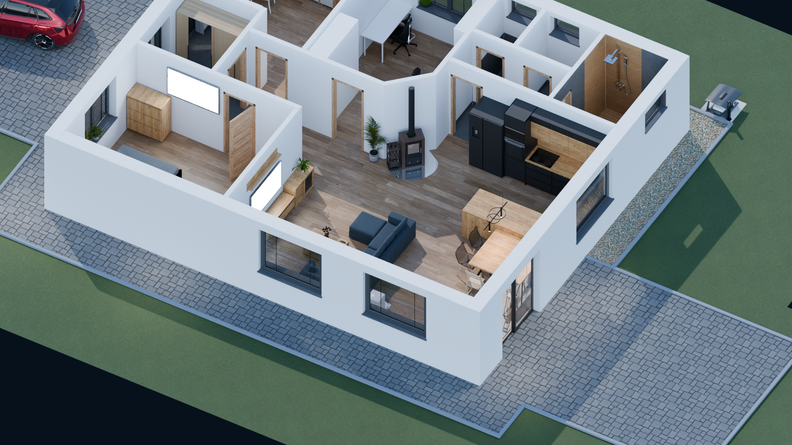
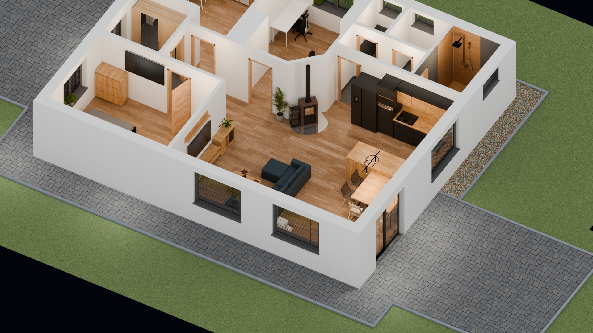
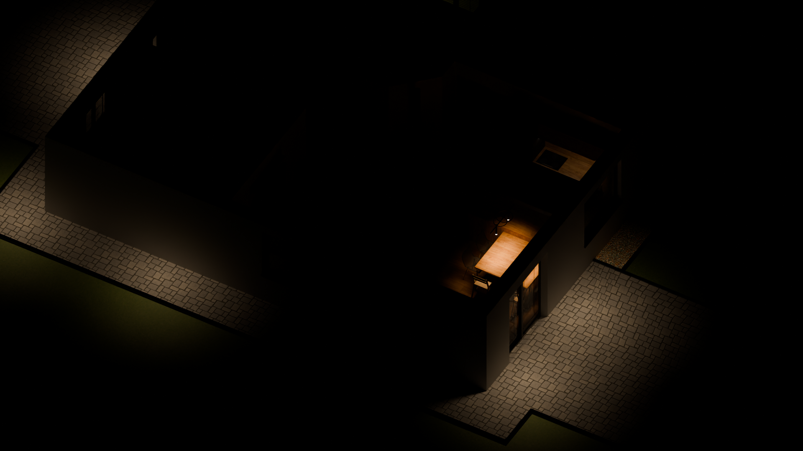

# BlenderHome3D

> **1:1 Parametrický a fotorealistický 3D model rodinného domu v Blenderu 5.2+**  
> Kompletní architektonický model připravený pro integraci do **Home Assistant Floorplan**: reálná výška stěn $2.5\,\text{m}$, 1-click kolekce osvětlení (denní / noční režimy), PBR materiály, autentická venkovní zahrada a oficiální model vozu **Škoda Scala Monte Carlo 2025** na příjezdové cestě.

[](https://github.com/VasoCZ/BlenderHome3D/releases/tag/v2.0-master)
[](https://www.blender.org/)
[](https://docs.blender.org/api/current/)
[](LICENSE)

---

## 📸 1. Hlavní Půdorysy (Home Assistant Master Floorplans)

Model nabízí 4 nativní, deterministicky vyrenderované režimy pro interaktivní floorplan v Home Assistantu:

| Denní přehled (Slunce ON + Interiérová svítidla ON) | Čisté denní světlo (Slunce ON + Svítidla OFF) |
| :---: | :---: |
| [](dum_pudorys_overview.png) | [](dum_pudorys_daylight_final.png) |
| **Noční přehled (Slunce OFF + Interiér & Fasáda ON)** | **Tmavá noc (Slunce OFF + Všechna světla OFF)** |
| [](dum_pudorys_night_overview.png) | [](dum_pudorys_night_dark.png) |

---

## 🚗 2. Vozidlo: Škoda Scala Monte Carlo 2025

Na dlážděné příjezdové cestě před hlavním vchodem je zaparkován plnohodnotný, autentický model vozu **Škoda Scala Monte Carlo (facelift 2024/2025)** sestavený z oficiálních CAD dat Škoda Auto:

- **Karoserie a lak**: Autentická metalíza *Velvet Red* v kombinaci s paketem *Monte Carlo Black Magic* (lesklá černá střecha, boční zrcátka, difuzor, spoiler a spodní splitter).
- **Maska chladiče**: Černá osmiúhelníková maska chladiče Monte Carlo s vertikálními lamelami a černým sacím otvorem v nárazníku.
- **Kola 17" Kajam Monte Carlo**: 5 aerodynamických krycích lamel, vnitřní kapsy a hluboký barel v černém finiši, vnější obvodový límec a centrální emblém v broušeném hliníku dle reálných fotografií. Brzdové kotouče a červené třmeny.
- **Zatmavená skla Sunset Privacy Glass**: Zadní okna dveří, pevná trojúhelníková okénka v C-sloupku (nad víčkem palivové nádrže i na protější straně) a páté dveře s prodlouženým zadním sklem mají hluboké tónování privacy glass. Přední okna a čelní sklo zůstávají v čirém bezpečnostním skle bez nežádoucích přetoků na karoserii.
- **Přední stěrače**: Černá ramínka a lišty stěračů zapuštěné v plastovém torpédu pod čelním sklem.
- **Registrační značky**: Autentické české SPZ `1AH U743` s rámečky vpředu i vzadu.

### Detailní inspekční pohledy vozu

| Pohled 3/4 zepředu | Pohled 3/4 zezadu |
| :---: | :---: |
|  |  |
| **Pravý profil (okno v C-sloupku nad nádrží)** | **Levý profil (přední čirá & zadní tónovaná skla)** |
|  |  |
| **Černé přední stěrače a torpédo** | **Detail tónovaného okna v C-sloupku** |
|  |  |

---

## 🏡 3. Exteriér a Zahrada

- **Robotická sekačka Mammotion Yuka 2000**:
  - Fotorealistický model sekačky zaparkovaný v originální garáži se stříškou na betonové podestě ($Z = 0.00\,\text{m}$ až $0.06\,\text{m}$).
  - Vedení a kolmost zarovnány striktně podle severní obvodové stěny.
- **Zpevněné plochy a obrubníky**:
  - Příjezdová cesta z betonové zámkové dlažby s obrubníky zarovnanými v úrovni pojezdu.
  - Zahradní terasa navazující na francouzské dveře s čistou spárou a zapuštěním.
  - Drenážní kačírek podél obvodu domu s plastovými zahradními obrubníky oddělujícími travnatou plochu.

| Zámková dlažba a stání vozu (den) | Příjezdová cesta v nočním osvětlení |
| :---: | :---: |
|  |  |

---

## 📐 4. Standardy Projektu & Pravidla Modelování

### 4.1 Standard okenních žaluzií
- **Materiál**: Černý polomatný kov `Mat_Kitchen_Black_Metal`.
- **Komponenty**: Horní krycí kazeta, horizontální lamely (rozteč $50\text{--}55\,\text{mm}$, náklon $25^\circ\text{--}30^\circ$), spodní zatěžovací lišta a boční vodící lanka.
- **Francouzská okna (1.04 Obývací pokoj)**: Dvě samostatná křídla pro každé dveřní křídlo zvlášť s délkou od podlahového prahu ($Z \approx 0.12\,\text{m}$) po horní rám ($Z \approx 2.18\,\text{m}$).

### 4.2 Standard dřevodekoru (Kronospan K003 Gold Craft Oak)
Jednotný prémiový dekor dubu `Mat_Kronospan_K003_Gold_Craft_Oak` je aplikován na:
- Jídelní stůl a židle
- Obývací pokoj: TV konzole, konferenční stolek, prosklená vitrína a zrcadlová police
- Ložnice (1.05): šatní komoda
- Dětský pokoj (1.06): policový regál Kallax

### 4.3 Fyzikální realismus pro Home Assistant
- Žádné umělé 2D/3D plameny v krbu ani svítící plochy spotřebičů v klidovém stavu.
- Nábytek striktně respektuje dráhu otevírání dveří a oken.
- Žádné procedurální zjednodušené bloky připomínající Minecraft – všechny prvky jsou autentické modely s přesnými proporcemi a PBR texturami.

| Žaluzie v ložnici | Obývací pokoj s dekorem K003 |
| :---: | :---: |
|  |  |
| **Noční atmosféra obývacího pokoje** | **Koupelna s dlažbou a dřevem** |
|  |  |

---

## ⚡ 5. Rychlé Spuštění & Automatizace

### Vyrenderování všech 4 master floorplanů pro Home Assistant
Spustí nativní dávkový Cycles renderer, přepne jednotlivé outliner kolekce a vygeneruje všechny 4 půdorysy a kontrolní výřezy:
```powershell
& "C:\Program Files\Blender Foundation\Blender 5.2\blender.exe" -b "dum_pudorys.blend" -P "render_exact_user_modes.py"
```

### Sestavení a integrace vozu Škoda Scala
Pro znovuvytvoření a namapování oficiální CAD geometrie vozu Škoda Scala:
```powershell
& "C:\Program Files\Blender Foundation\Blender 5.2\blender.exe" -b "dum_pudorys.blend" -P "scratch/build_final_scala.py"
```

---

## 💾 6. Zálohování & Vydání „Alfa“

Kompletní archiv scény včetně objemného 3D souboru `.blend` (cca $1.08\,\text{GB}$), oficiálních CAD součástí, textur a všech renderů je archivován ve vydání **Alfa**:

- 📦 **ZIP Archiv**: [`dum_pudorys_alfa.zip`](dum_pudorys_alfa.zip) (1 087,6 MB)
- 🚀 **GitHub Release**: [Vydání Alfa na GitHubu](https://github.com/VasoCZ/BlenderHome3D/releases/tag/alfa)
- 📌 **Git Tag**: `alfa`

---

## 📖 7. Technická Specifikace 1:1

Podrobný rozpis všech stěn, otvorů, elektroinstalace a souřadnic naleznete v technické dokumentaci:  
👉 **[BUILD_SPECIFICATION_1TO1.md](BUILD_SPECIFICATION_1TO1.md)**
