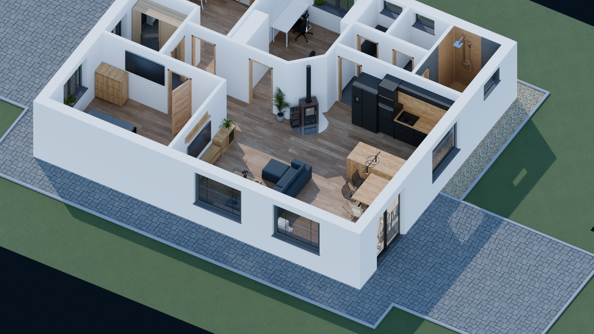
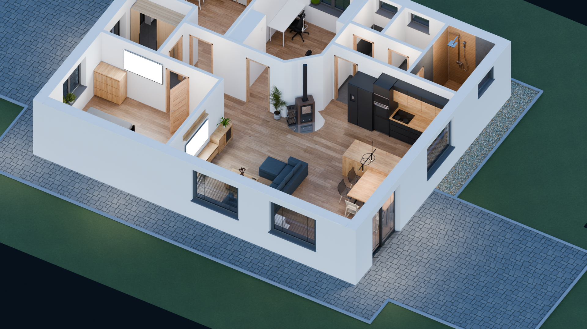

# BlenderHome3D

> **1:1 Parametrický a procedurální 3D model rodinného domu v Blenderu 5.2+**  
> Kompletní architektonický model s reálnou výškou stěn $2.5\,\text{m}$, přesným spárořezem keramické dlažby navazujícím na sokly, začištěnými stavebními otvory, 100% ortogonální základovou deskou, elektroinstalací a PBR materiály.

---

## 📸 Náhledy a Výsledky Modelování

| Denní režim (Slunečno 5500 K + Sky Fill) | Noční režim (#02050D ambient + 3000 K teplé světlo + OLED TV) |
| :---: | :---: |
|  |  |

---

## 🚀 Rychlý Start (1:1 Aplikace všech úprav)

Pro kompletní deterministickou aplikaci všech stavebních řezů, soklíků, spárořezů a generování kontrolních renderů stačí spustit jediný příkaz:

```powershell
& "C:\Program Files\Blender Foundation\Blender 5.2\blender.exe" --background --python apply_all_tiles_and_skirting.py
```

Skript provede:
1. **Obnovení čisté geometrie** z výchozí zálohy.
2. **Procedurální zarovnání spárořezu** (`sokl chodba` a `sokl chodba.001` v `Texture Coordinate: Object` ladící s `koupelna`).
3. **Konstrukci $15\,\text{cm}$ soklíků** po celém obvodu technické místnosti (1.09), chodby (1.11) a zádveří (1.01).
4. **WC obklad do výšky $1.15\,\text{m}$** a uzavření spáry za toaletou.
5. **Koupelnu (1.10)** s dřevěným sprchovým koutem a bílou korunkou obvodové zdi ve výšce $Z = 2.50\,\text{m}$.
6. **Masivní prahy z šedé dlažby** (101_102 a 104_111) a zapuštění zámkové dlažby pod HS portálem na $Z = -0.07\,\text{m}$.
7. **Vyrenderování všech kontrolních pohledů** v rozlišení Full HD.

---

## 📐 Podrobná 1:1 Specifikace

Kompletní matematický a technický rozpis každé stěny, otvoru, světla a materiálu naleznete v samostatném souboru:  
👉 **[BUILD_SPECIFICATION_1TO1.md](BUILD_SPECIFICATION_1TO1.md)**

---

## 🛠️ Požadavky na Systém
- **Blender**: verze 5.2+ LTS
- **OS**: Windows / Linux / macOS
- **Python**: Vestavěný v Blenderu (`bpy`, `bmesh`, `mathutils`)
