# BlenderHome3D

> **1:1 Parametrický a fotorealistický 3D model rodinného domu v Blenderu 5.2+**  
> Kompletní architektonický model připravený pro integraci do **Home Assistant Floorplan (HA 2.0)**: reálná výška stěn $2.5\,\text{m}$, 1-click kolekce osvětlení (denní / noční režimy), PBR materiály, autentická venkovní zahrada a oficiální model vozu **Škoda Scala Monte Carlo 2025** na příjezdové cestě.

[](https://github.com/VasoCZ/BlenderHome3D/releases/tag/v2.0-master)
[](https://www.blender.org/)
[](https://docs.blender.org/api/current/)
[](LICENSE)

---

## 📸 1. Home Assistant 2.0 – Interaktivní 4K Půdorysy

Model disponuje kompletní sadou **23 nativních 4K UHD renderů (`3840 × 2160`)** optimalizovaných pro `picture-elements` kartu v Home Assistantu s podporou přítomnosti vozidla a transparentních vrstev jednotlivých svítidel a spotřebičů:

### 1.1 Základní stavy podkladu (Base Layers)

| Den s autem | Den bez auta |
| :---: | :---: |
| [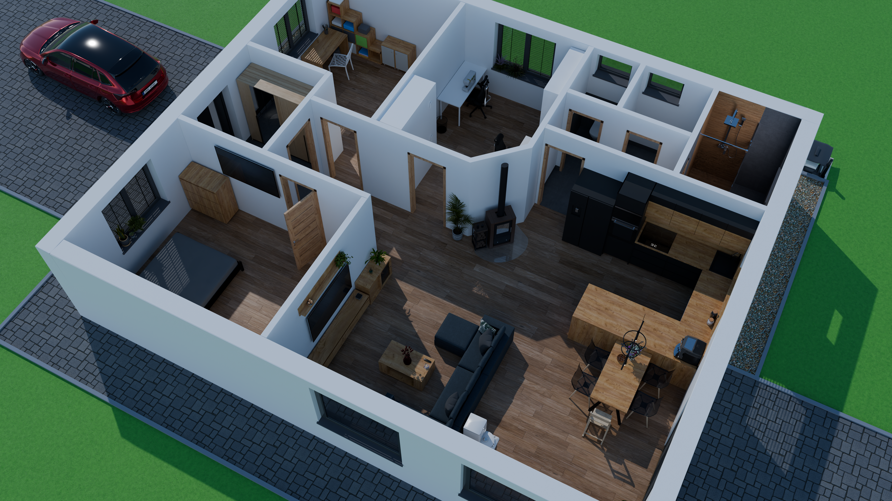](renders_ha_2.0/Den.png) | [](renders_ha_2.0/Den%20-%20bez%20auta.png) |
| **Noc s autem** | **Noc bez auta** |
| [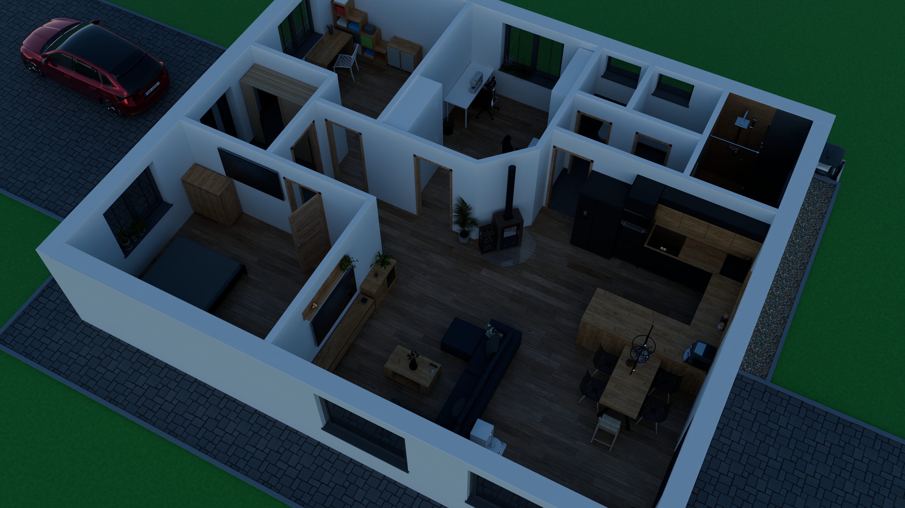](renders_ha_2.0/Noc.png) | [](renders_ha_2.0/Noc%20-%20bez%20auta.png) |

---

### 1.2 Interaktivní vrstvy osvětlení a zařízení (4K Overlay Layers)

Jednotlivé vrstvy s transparentním pozadím pro dynamické spínání v Home Assistantu:

| Místnost / Prvek | Náhled vrstvy | Cesta k souboru |
| :--- | :---: | :--- |
| **Kuchyně (1.03)** | [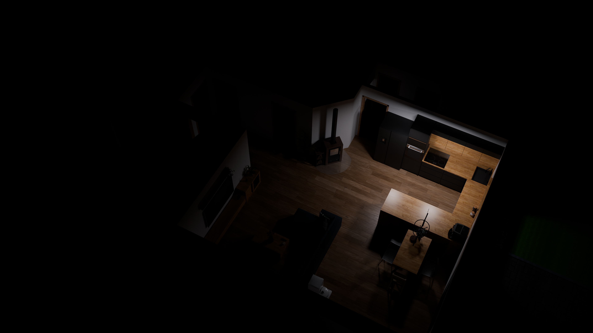](renders_ha_2.0/kuchyn.png) | `renders_ha_2.0/kuchyn.png` |
| **Obývací pokoj (1.04)** | [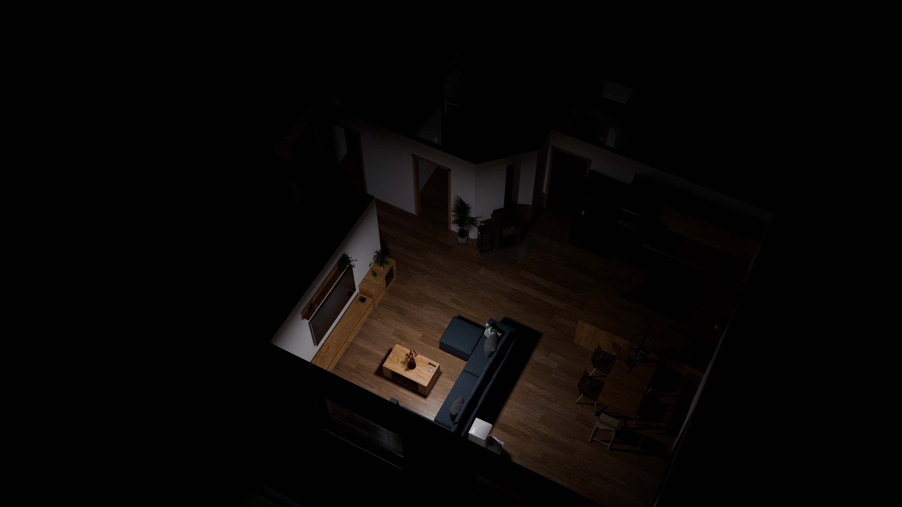](renders_ha_2.0/obyvak.png) | `renders_ha_2.0/obyvak.png` |
| **Obývací pokoj – TV** | [](renders_ha_2.0/TV%20obyvak.png) | `renders_ha_2.0/TV obyvak.png` |
| **Jídelní stůl (pendant)** | [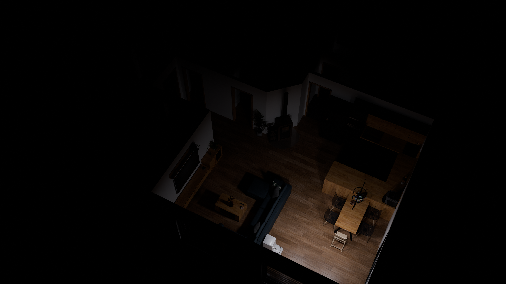](renders_ha_2.0/jidelna.png) | `renders_ha_2.0/jidelna.png` |
| **Jídelna 2** | [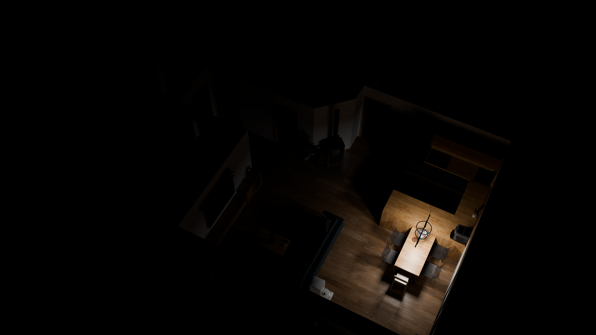](renders_ha_2.0/jidelna2.png) | `renders_ha_2.0/jidelna2.png` |
| **Chodba hlavní (1.02)** | [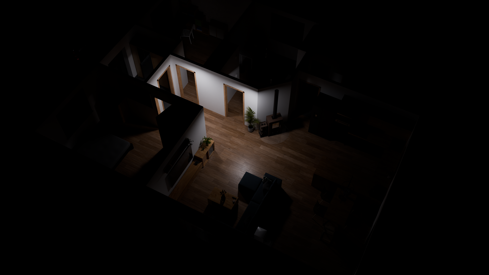](renders_ha_2.0/chodba.png) | `renders_ha_2.0/chodba.png` |
| **Chodba sever (1.11)** | [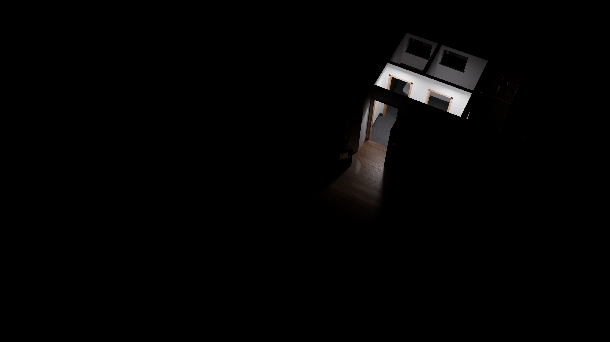](renders_ha_2.0/chodba2.png) | `renders_ha_2.0/chodba2.png` |
| **Zádveří / Předsíň (1.01)** | [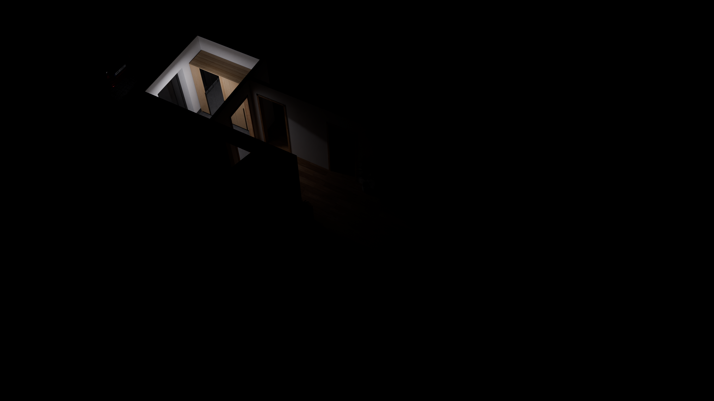](renders_ha_2.0/predsin.png) | `renders_ha_2.0/predsin.png` |
| **Ložnice – Strop (1.05)** | [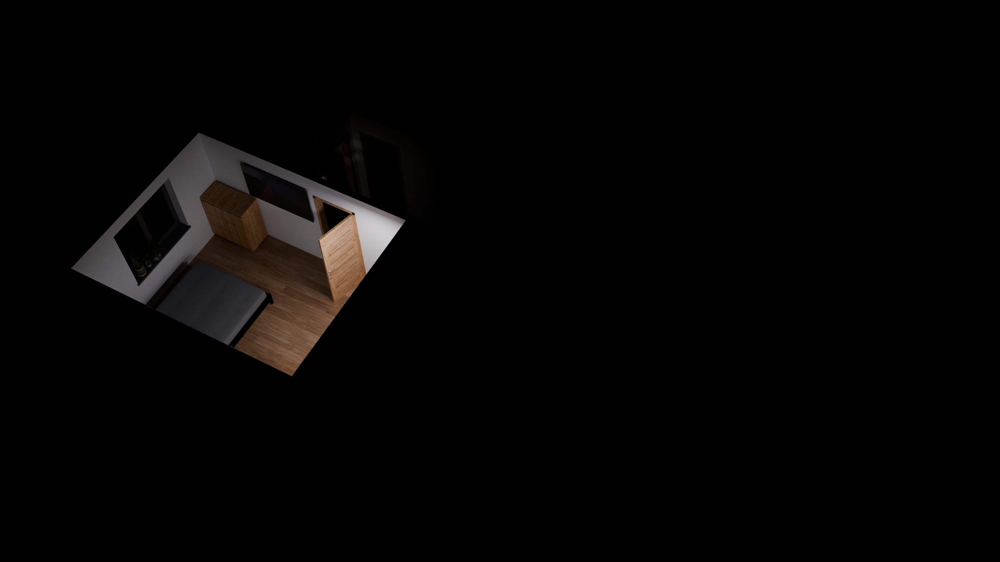](renders_ha_2.0/loznice_skrin.png) | `renders_ha_2.0/loznice_skrin.png` |
| **Ložnice – Bodovky (1.05)** | [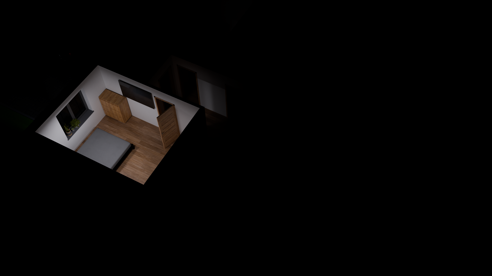](renders_ha_2.0/loznicepostel.png) | `renders_ha_2.0/loznicepostel.png` |
| **Ložnice – TV** | [](renders_ha_2.0/TV%20loznice.png) | `renders_ha_2.0/TV loznice.png` |
| **Dětský pokoj (1.06)** | [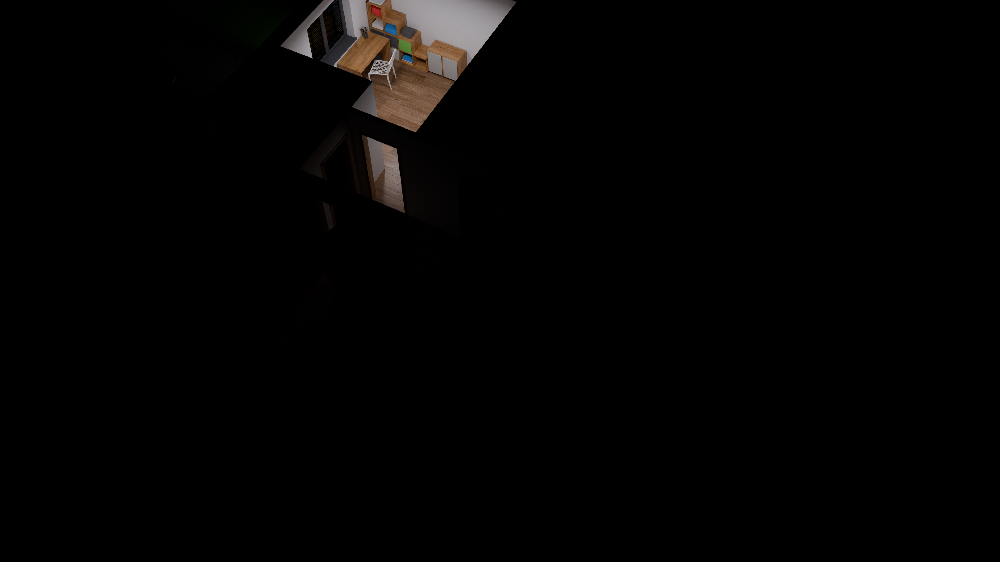](renders_ha_2.0/vituvpokoj.png) | `renders_ha_2.0/vituvpokoj.png` |
| **Pracovna (1.07)** | [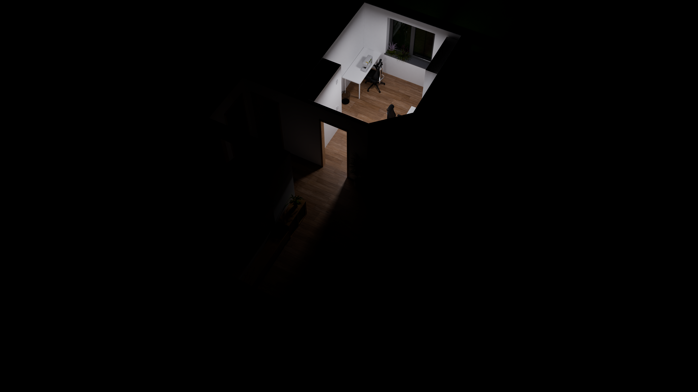](renders_ha_2.0/pracovna.png) | `renders_ha_2.0/pracovna.png` |
| **Koupelna (1.10)** | [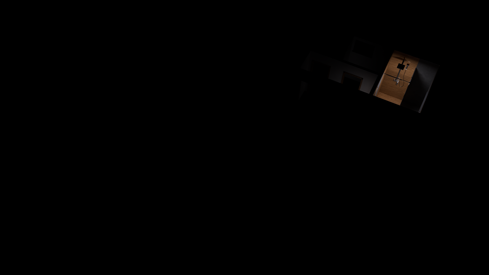](renders_ha_2.0/koupelna.png) | `renders_ha_2.0/koupelna.png` |
| **Samostatné WC (1.08)** | [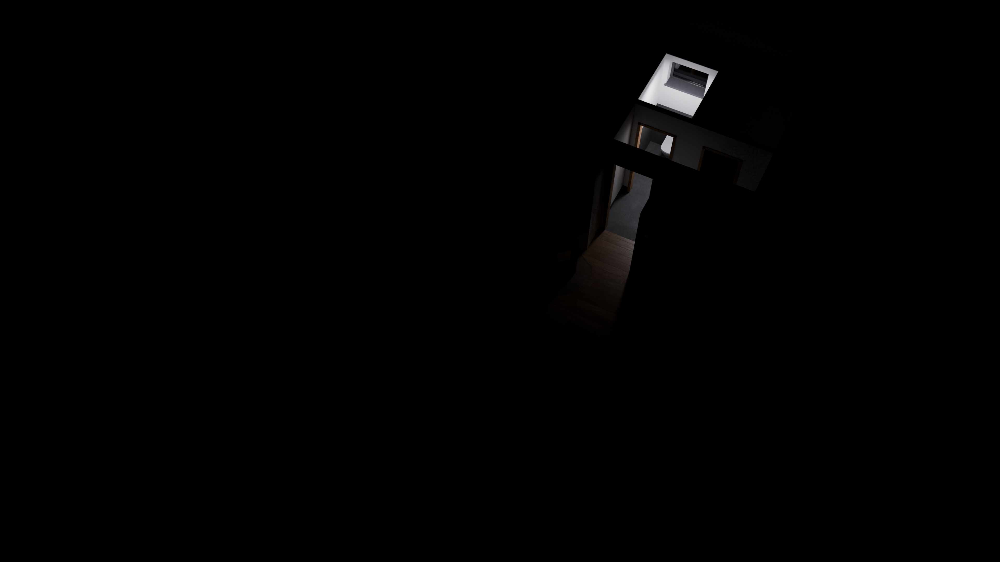](renders_ha_2.0/zachod.png) | `renders_ha_2.0/zachod.png` |
| **Technická místnost (1.09)**| [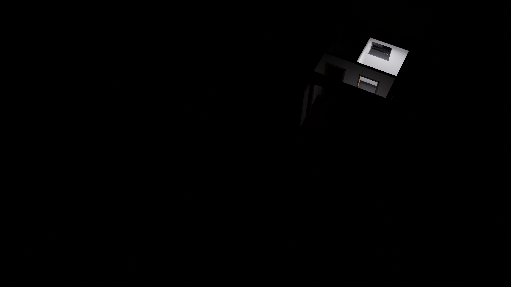](renders_ha_2.0/technicka.png) | `renders_ha_2.0/technicka.png` |
| **Terasa levá strana** | [](renders_ha_2.0/terasa%20leve.png) | `renders_ha_2.0/terasa leve.png` |
| **Terasa pravá strana** | [](renders_ha_2.0/terasa%20prave.png) | `renders_ha_2.0/terasa prave.png` |
| **Venkovní podhledy** | [](renders_ha_2.0/venkovni%20osvetleni.png) | `renders_ha_2.0/venkovni osvetleni.png` |
| **Robotický vysavač Dreame L40 Ultra (běh)** | [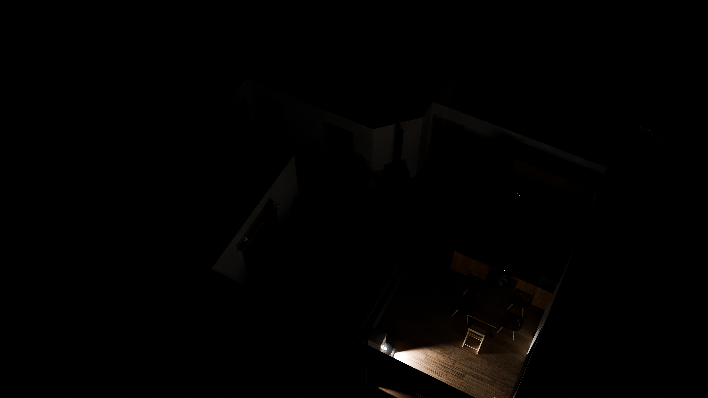](renders_ha_2.0/vysavac.png) | `renders_ha_2.0/vysavac.png` |

---

## 🚗 2. Vozidlo: Škoda Scala Monte Carlo 2025

Na dlážděné příjezdové cestě před hlavním vchodem je zaparkován plnohodnotný, autentický model vozu **Škoda Scala Monte Carlo (facelift 2024/2025)** sestavený z oficiálních CAD dat Škoda Auto:

- **Karoserie a lak**: Autentická metalíza *Velvet Red* v kombinaci s paketem *Monte Carlo Black Magic* (lesklá černá střecha, boční zrcátka, difuzor, spoiler a spodní splitter).
- **Maska chladiče**: Černá osmiúhelníková maska chladiče Monte Carlo s vertikálními lamelami a černým sacím otvorem v nárazníku.
- **Kola 17" Kajam Monte Carlo**: 5 aerodynamických krycích lamel, vnitřní kapsy a hluboký barel v černém finiši, vnější obvodový límec a centrální emblém v broušeném hliníku dle reálných fotografií. Brzdové kotouče a červené třmeny.
- **Zatmavená skla Sunset Privacy Glass**: Zadní okna dveří, pevná trojúhelníková okénka v C-sloupku a páté dveře s prodlouženým zadním sklem mají hluboké tónování privacy glass. Přední okna a čelní sklo zůstávají v čirém bezpečnostním skle bez nežádoucích přetoků na karoserii.
- **Přední stěrače**: Černá ramínka a lišty stěračů zapuštěné v plastovém torpédu pod čelním sklem.
- **Registrační značky**: Autentické české SPZ `1AH U743` s rámečky vpředu i vzadu.

### Detailní inspekční pohledy vozu

| Pohled 3/4 zepředu | Pohled 3/4 zezadu |
| :---: | :---: |
| 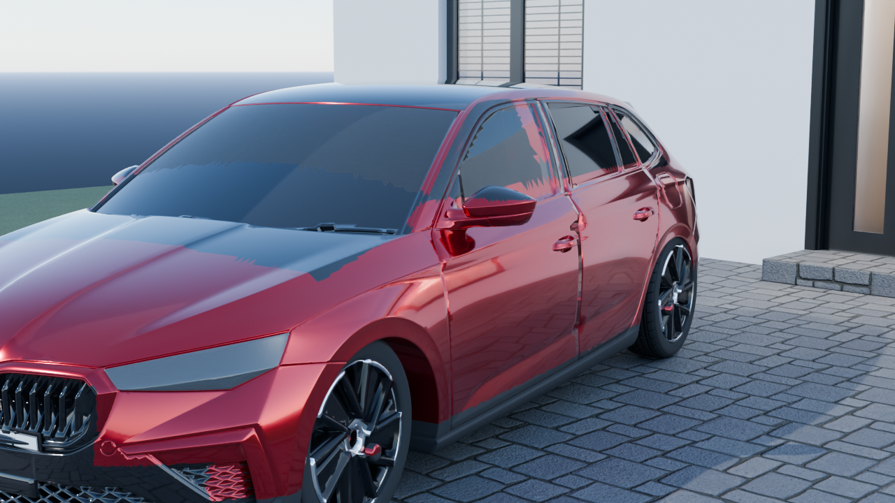 | 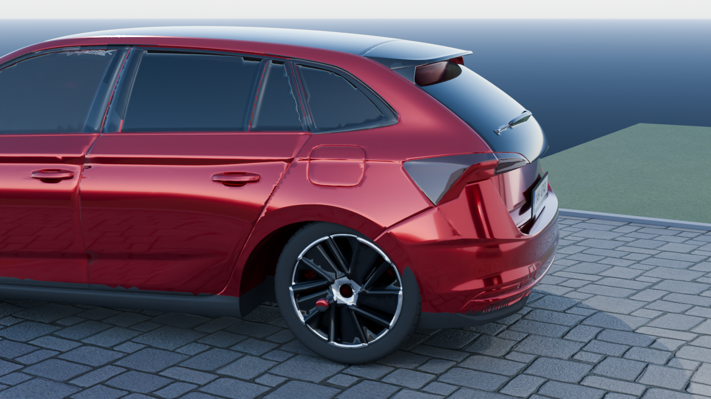 |
| **Pravý profil (okno v C-sloupku nad nádrží)** | **Levý profil (přední čirá & zadní tónovaná skla)** |
| 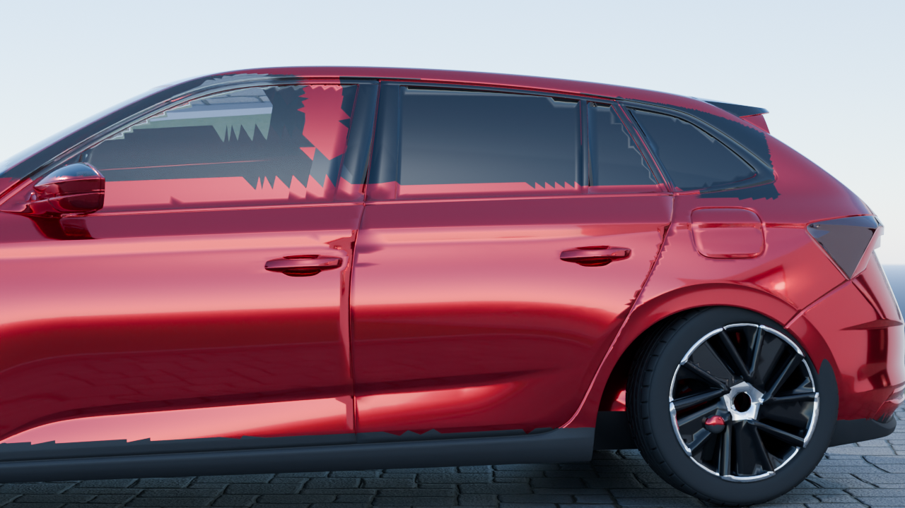 | 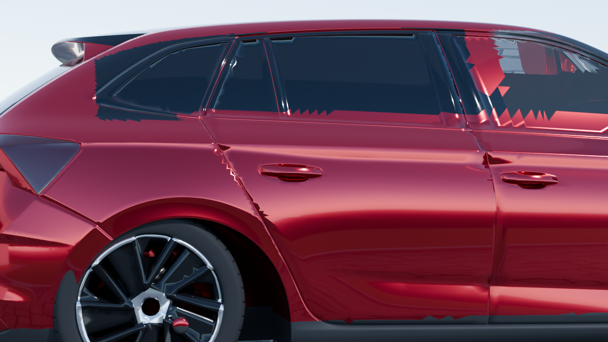 |
| **Černé přední stěrače a torpédo** | **Detail tónovaného okna v C-sloupku** |
| 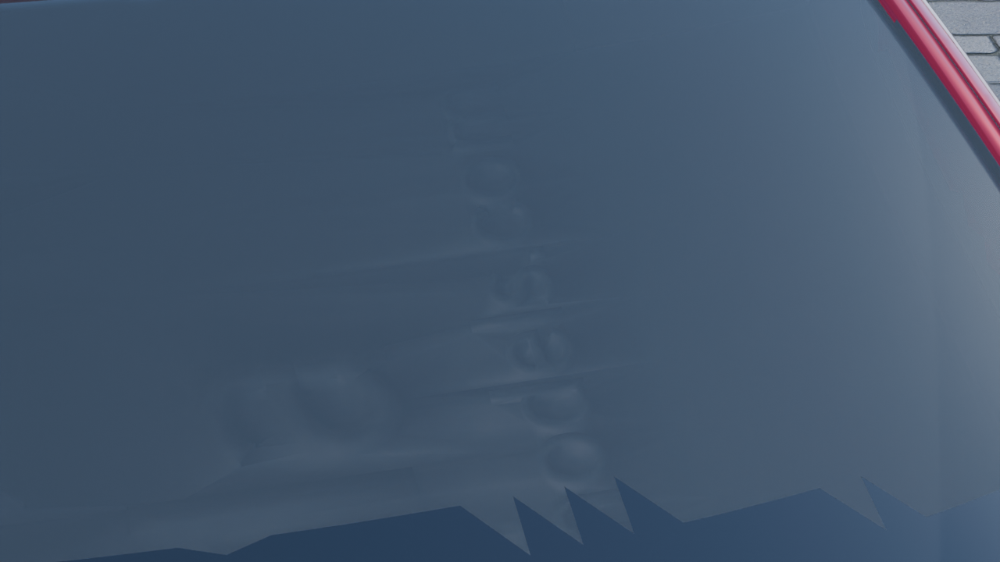 | 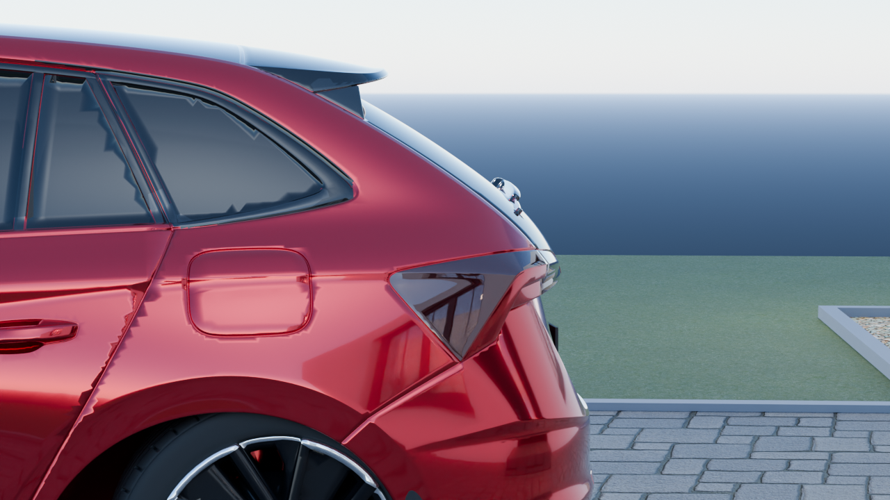 |

---

## 🏡 3. Exteriér a Zahrada

- **Robotická sekačka Mammotion Yuka 2000**:
  - Fotorealistický model sekačky zaparkovaný v originální garáži se stříškou na betonové podestě ($Z = 0.00\,\text{m}$ až $0.06\,\text{m}$).
  - Vedení a kolmost zarovnány striktně podle severní obvodové stěny.
- **Zpevněné plochy a venkovní dlažba**:
  - Příjezdová cesta z betonové zámkové dlažby (`Paving Stones`) protažená na jih k $Y = -22.0\,\text{m}$ s exaktním UV mapováním 1:1, zaručujícím dokonale stejné čtvercové rozměry dlaždic po celé délce.
  - Zahradní terasa navazující na francouzské dveře s čistou spárou a zapuštěním.
  - Drenážní kačírek podél obvodu domu s plastovými zahradními obrubníky oddělujícími travnatou plochu.
  - Trávník (`Lawn_Ground`, $55 \times 55\,\text{m}$) kompletně vyplňuje všechny 4 rohy a okraje 4K záběru bez transparentních mezer.

| Zámková dlažba a stání vozu (den) | Příjezdová cesta v nočním osvětlení |
| :---: | :---: |
| 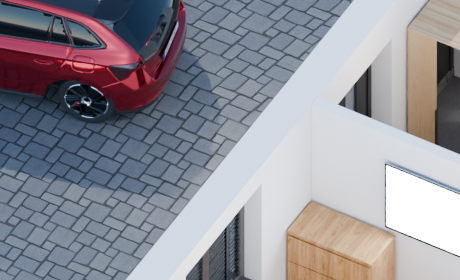 | 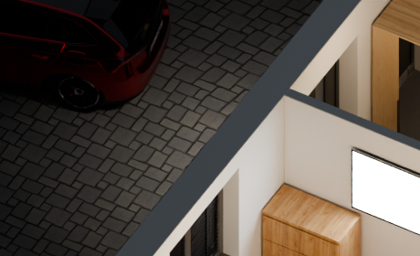 |

---

## 📐 4. Standardy Projektu & Pravidla Modelování

### 4.1 Standard okenních žaluzií
- **Materiál**: Černý polomatný kov `Mat_Kitchen_Black_Metal`.
- **Komponenty**: Horní krycí kazeta, horizontální lamely (rozteč $50\text{--}55\,\text{mm}$, náklon $25^\circ\text{--}30^\circ$), spodní zatěžovací lišta a boční vodící lanka.
- **Francouzská okna (1.04 Obývací pokoj)**: Dvě samostatná křídla pro každé dveřní křídlo zvlášť s délkou od podlahového prahu ($Z \approx 0.12\,\text{m}$) po horní rám ($Z \approx 2.18\,\text{m}$).

### 4.2 Standard dřevodekoru (Kronospan K003 Gold Craft Oak)
Jednotný prémiový dekor dubu `Mat_Kronospan_K003_Gold_Craft_Oak` je aplikován na:
- Jídelní stůl a židle
- Obývací pokoj: TV konzole, konferenční stolek, prosklená vitrína a zrcadlová police
- Ložnice (1.05): šatní komoda
- Dětský pokoj (1.06): policový regál Kallax

### 4.3 Osvětlení scény (Pure White #FFFFFF)
- Všech 34 světel ve scéně (datablocky `bpy.data.lights` typu AREA, SPOT, SUN i shaderové nody `Emission`) je nastaveno na čistě bílý tint `RGB (1.0, 1.0, 1.0)` bez teplých či studených barevných závojů.

### 4.4 Koupelna a walk-in sprchová zástěna (1.10)
- Koupelna vybavena autentickou walk-in sprchovou zástěnou z čirého bezpečnostního skla s černým kovovým lemováním a stropní stabilizační vzpěrou dle reálné fotodokumentace.

### 4.5 Robotický vysavač Dreame L40 Ultra (aktivní světla na vypínání)
- **Kolekce `Dreame_Active_Lights`**: Obsahuje svítící prvky na vysavači s 1-klik přepínáním v Outlineru (ikona oka/kamery) pro renderování běžícího vysavače.
- **Přední LED světlomety**: Boostnuté čočky (`Mat_Dreame_Headlight_Active`, síla 350) + směrové kužely (`Light_Dreame_Headlights_Beam`, 55W celkem) osvětlující dřevěnou podlahu před vysavačem.
- **Stavový indikátor na těle**: Centrální zapínací tlačítko s ledově bílým podsvícením (`Mat_Dreame_Button_Active`, síla 120), které je zřetelně viditelné i z horního izometrického pohledu.

| Žaluzie v ložnici | Obývací pokoj s dekorem K003 |
| :---: | :---: |
| 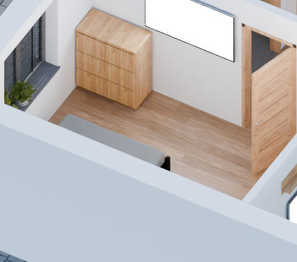 | 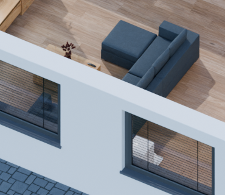 |
| **Noční atmosféra obývacího pokoje** | **Koupelna s dlažbou a dřevem** |
| 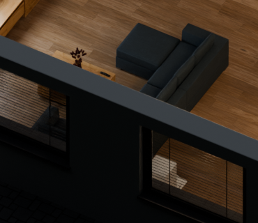 | 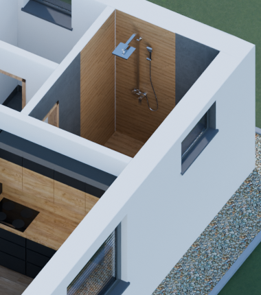 |

---

## ⚡ 5. Rychlé Spuštění & Automatizace

### Sestavení skleněné sprchové zástěny:
```powershell
& "C:\Program Files\Blender Foundation\Blender 5.2\blender.exe" -b "dum_pudorys.blend" -P "build_shower_screen.py"
```

### Sestavení a integrace vozu Škoda Scala
Pro znovuvytvoření a namapování oficiální CAD geometrie vozu Škoda Scala:
```powershell
& "C:\Program Files\Blender Foundation\Blender 5.2\blender.exe" -b "dum_pudorys.blend" -P "scratch/build_final_scala.py"
```

### Přepnutí světel vysavače Dreame L40 Ultra:
```powershell
& "C:\Program Files\Blender Foundation\Blender 5.2\blender.exe" -b "dum_pudorys.blend" -P "toggle_dreame_lights.py"
```

### Vygenerování záložního archivu projektu
```powershell
python "create_backup_archive.py"
```

---

## 💾 6. Zálohování & Vydání „v2.0-master“

Kompletní archiv scény včetně objemného 3D master souboru `.blend` (cca $1.17\,\text{GB}$), oficiálních CAD součástí, PBR textur, všech 23 interaktivních 4K renderů a dokumentace je archivován v oficiálním vydání:

- 📦 **ZIP Archiv**: [`dum_pudorys_master_backup.zip`](dum_pudorys_master_backup.zip) (1 263,1 MB)
- 🚀 **GitHub Release**: [Vydání v2.0-master na GitHubu](https://github.com/VasoCZ/BlenderHome3D/releases/tag/v2.0-master)
- 📌 **Git Tag**: `v2.0-master`

---

## 📖 7. Technická Specifikace 1:1

Podrobný rozpis všech stěn, otvorů, elektroinstalace a souřadnic naleznete v technické dokumentaci:  
👉 **[BUILD_SPECIFICATION_1TO1.md](BUILD_SPECIFICATION_1TO1.md)**
